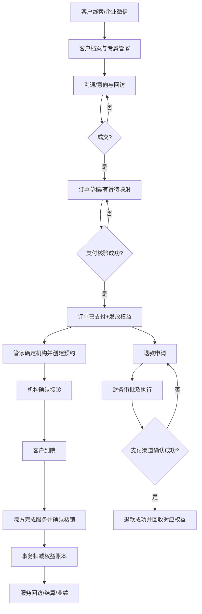

# 11 业务流程与状态机（不可跳过）

## 1. 生命周期总图

## 2. 订单状态（事件驱动）
`DRAFT → PENDING_PAYMENT → PAID → PARTIALLY_REDEEMED → FULFILLED`；取消从未支付状态转 `CANCELED`；已支付出现退款申请时通过**退款子域状态**呈现，不直接覆盖订单原支付事实。每次变更记 `order_status_history` 和 `audit_event`。禁止 `DRAFT → FULFILLED` 或 AI 直接设置 `PAID`。

支付：`PENDING → CONFIRMED / FAILED / REVERSED`，只有有权限且可验证的支付来源可确认；订单每个支付渠道交易号唯一。

## 3. 会员权益状态
权益批次 `PENDING → AVAILABLE → EXHAUSTED / EXPIRED / REVOKED`；部分使用仍为 AVAILABLE。余额不作为唯一持久状态，而是 `entitlement_txn` 正负流水汇总（可维护用于快速查询的、同事务刷新的快照）。

流水类型：`GRANT` 正，`REDEEM` 负，`REFUND_REVOKE` 负，`CORRECTION_IN` 正，`CORRECTION_OUT` 负，`EXTEND` 只变有效期且审计。每一条必须有 `source_type`, `source_id`, `idempotency_key`, `actor`, `reason`。原记录不可删除。

**不可突破的不变量：**可用次数 >= 0（除运营明确批准的异常修复隔离状态）、已核销次数+已退款回收次数 <= 已发放+批准增加次数、每条有效核销只有一条对应负流水、退款现金交易和权益回收逐笔关联。

## 4. 预约与院方核销
预约状态：`PENDING_INSTITUTION → CONFIRMED → CHECKED_IN → SERVICE_DONE → REDEEMED`；拒绝/取消可到 `REJECTED/CANCELED`；违约/未到院 `NO_SHOW`。实际到院不可通过聊天自动标为完成。

核销请求 `SUBMITTED → PENDING_INSTITUTION → POSTED / REJECTED`。仅医院授权角色可将 POSTED；特殊冲正须另起 `REDEMPTION_REVERSAL` 审批，**不要 UPDATE 旧 POSTED**。将 `redemption` 的唯一预约/幂等键固定约束，避免“双击核销”产生两条可用权益扣减。

医院服务 2 个子项目时必须分别指定权益批次和核销次数，不能只选套餐总次数。原规格中“选 N 项”必须先在订单内物化实际选项，再进行核销。

## 5. 退款
`REQUESTED → UNDER_REVIEW → APPROVED → PROCESSING → SUCCEEDED`，也可 `REJECTED/CANCELED/FAILED`。付款途径退回成功后才计入退款总额与执行权益回收事务；支付回调重复只登记一次。对已消费项目的现金退款不自动归还次数，必须指明业务方案和人工审核。

## 6. 机构资料审批
`DRAFT → SUBMITTED → MARKET_REVIEW? → FINANCE_REVIEW? → EFFECTIVE / REJECTED / CANCELED`。`?` 表示依据变更字段审批矩阵；银行账户等走财务审核，佣金/保证金/合同类默认双审（最终由 Q08 签定）。批准之前 `institution` 正式字段**不得改变**。申请人不能审核本人申请；原值、新值、审核角色、审核人、时间与理由持久保留。

## 7. 客户合并/转交
合并 `SUGGESTED → REVIEWING → CONFIRMED / REJECTED`；先锁主、从客户，迁移关联表外键或创建 identity alias，保证客户 ID 不重复、事件审计不可被覆盖；跨团队与跨权限须审批。转交 `PENDING → APPROVED → EFFECTIVE`；成交归属保留订单时点快照。

错误合并不删除或覆盖原合并历史，通过 `crm_merge_reversal` 走 `REQUESTED → EXECUTED / MANUAL_REVIEW / REJECTED`，执行异常进入 `ERROR` 并保留脱敏错误及审计。只有 `CONFIRMED` 可申请更正；申请使用 `customer:merge`，审批、人工完成和驳回使用 `customer:merge_reverse`，双方客户均须在当前用户数据范围内，写接口要求 CSRF、幂等键和审计。

- 新合并确认前保存从客户的身份、标签、跟进、任务、积分、订单和权益 ID 快照。有快照时，审批只将这些 ID 迁回，恢复从客户并按账本重算双方积分缓存，原合并单改 `REVERSED`；主客户原有和合并后新增的数据不得被全量迁回。
- 历史无快照时，审批只恢复从客户并进入 `MANUAL_REVIEW`，原合并单保持 `CONFIRMED`。管理员人工逐项迁移确认后，填写处理说明完成，原合并单才改 `REVERSED`。
- 合并时去重删除的身份和标签不能自动恢复，必须展示警示并人工复核。支付、订单金额、权益发放及核销历史不因合并更正被覆盖。
- 驳回只关闭更正申请，不改变客户或原合并结果。申请、审批、人工完成、驳回和执行失败均追加审计。

## 8. 特殊补偿案例
- 有赞 webhook 两次且用户主动拉单：`source_system + external_order_no` 唯一，幂等状态更新，不重复权益发放。
- 核销被确认时网络断开：客户端使用同一 `Idempotency-Key` 重试，接口返回原核销结果。
- 同一权益两个院方并发核销：`SELECT ... FOR UPDATE` 锁权益，先成功一笔，后续余额不够则409；严禁 Redis 锁单独承担保证。
- 合同审批完成时机构资料已被其他流程更新：检查审批单的 `base_version`，若不一致暂停执行并要求复核。
- 会话监控和 AI 的“客户说已做完服务”只产线索，不是 `POSTED` 服务事实。

### 客户合并关联保护（0.1.1）

自动合并迁移的订单或权益若已有预约、核销或退款关联，返回 CONFLICT，不迁移历史事实；自动撤销只检查快照中将迁回的订单和权益，存在关联时同样返回 CONFLICT。创建业务关联与迁移通过订单或权益锁协调；无快照的人工复核路径保持不变。接口和事件签名无变化。
