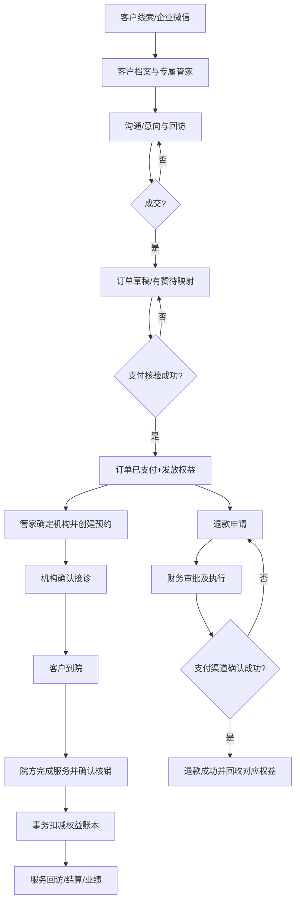

# 11 业务流程与状态机（不可跳过）

## 1. 生命周期总图


## 2. 订单状态（事件驱动）
`DRAFT → PENDING_PAYMENT → PAID → PARTIALLY_REDEEMED → FULFILLED`；取消从未支付状态转 `CANCELED`；已支付出现退款申请时通过**退款子域状态**呈现，不直接覆盖订单原支付事实。每次变更记 `order_status_history` 和 `audit_event`。禁止 `DRAFT → FULFILLED` 或 AI 直接设置 `PAID`。

支付：`PENDING → CONFIRMED / FAILED / REVERSED`，只有有权限且可验证的支付来源可确认；订单每个支付渠道交易号唯一。

## 3. 会员权益状态
权益批次 `PENDING → AVAILABLE → EXHAUSTED / EXPIRED / REVOKED`；部分使用仍为 AVAILABLE。余额不作为唯一持久状态，而是 `entitlement_txn` 正负流水汇总（可维护用于快速查询的、同事务刷新的快照）。

流水类型：`GRANT` 正，`REDEEM` 负，`REFUND_REVOKE` 负，`CORRECTION_IN` 正，`CORRECTION_OUT` 负，`EXTEND` 只变有效期且审计。每一条必须有 `source_type`, `source_id`, `idempotency_key`, `actor`, `reason`。原记录不可删除。

**不可突破的不变量：**可用次数 >= 0（除运营明确批准的异常修复隔离状态）、已核销次数+已退款回收次数 <= 已发放+批准增加次数、每条有效核销只有一条对应负流水、退款现金交易和权益回收逐笔关联。

## 4. 预约与院方核销
预约状态：`PENDING_INSTITUTION → CONFIRMED → CHECKED_IN → SERVICE_DONE → REDEEMED`；拒绝/取消可到 `REJECTED/CANCELED`；违约/未到院 `NO_SHOW`。实际到院不可通过聊天自动标为完成。

核销请求 `SUBMITTED → PENDING_INSTITUTION → POSTED / REJECTED`。仅医院授权角色可将 POSTED；特殊冲正须另起 `REDEMPTION_REVERSAL` 审批，**不要 UPDATE 旧 POSTED**。将 `redemption` 的唯一预约/幂等键固定约束，避免“双击核销”产生两条可用权益扣减。

医院服务 2 个子项目时必须分别指定权益批次和核销次数，不能只选套餐总次数。原规格中“选 N 项”必须先在订单内物化实际选项，再进行核销。

## 5. 退款
`REQUESTED → UNDER_REVIEW → APPROVED → PROCESSING → SUCCEEDED`，也可 `REJECTED/CANCELED/FAILED`。付款途径退回成功后才计入退款总额与执行权益回收事务；支付回调重复只登记一次。对已消费项目的现金退款不自动归还次数，必须指明业务方案和人工审核。

## 6. 机构资料审批
`DRAFT → SUBMITTED → MARKET_REVIEW? → FINANCE_REVIEW? → EFFECTIVE / REJECTED / CANCELED`。`?` 表示依据变更字段审批矩阵；银行账户等走财务审核，佣金/保证金/合同类默认双审（最终由 Q08 签定）。批准之前 `institution` 正式字段**不得改变**。申请人不能审核本人申请；原值、新值、审核角色、审核人、时间与理由持久保留。

## 7. 客户合并/转交
合并 `SUGGESTED → REVIEWING → CONFIRMED / REJECTED`；先锁主、从客户，迁移关联表外键或创建 identity alias，保证客户 ID 不重复、事件审计不可被覆盖；跨团队与跨权限须审批。转交 `PENDING → APPROVED → EFFECTIVE`；成交归属保留订单时点快照。

错误合并不删除或覆盖原合并历史，通过 `crm_merge_reversal` 走 `REQUESTED → EXECUTED / MANUAL_REVIEW / REJECTED`，执行异常进入 `ERROR` 并保留脱敏错误及审计。只有 `CONFIRMED` 可申请更正；申请使用 `customer:merge`，审批、人工完成和驳回使用 `customer:merge_reverse`，双方客户均须在当前用户数据范围内，写接口要求 CSRF、幂等键和审计。

- 新合并确认前保存从客户的身份、标签、跟进、任务、积分、订单和权益 ID 快照。有快照时，审批只将这些 ID 迁回，恢复从客户并按账本重算双方积分缓存，原合并单改 `REVERSED`；主客户原有和合并后新增的数据不得被全量迁回。
- 历史无快照时，审批只恢复从客户并进入 `MANUAL_REVIEW`，原合并单保持 `CONFIRMED`。管理员人工逐项迁移确认后，填写处理说明完成，原合并单才改 `REVERSED`。
- 合并时去重删除的身份和标签不能自动恢复，必须展示警示并人工复核。支付、订单金额、权益发放及核销历史不因合并更正被覆盖。
- 驳回只关闭更正申请，不改变客户或原合并结果。申请、审批、人工完成、驳回和执行失败均追加审计。

## 8. 特殊补偿案例
- 有赞 webhook 两次且用户主动拉单：`source_system + external_order_no` 唯一，幂等状态更新，不重复权益发放。
- 核销被确认时网络断开：客户端使用同一 `Idempotency-Key` 重试，接口返回原核销结果。
- 同一权益两个院方并发核销：`SELECT ... FOR UPDATE` 锁权益，先成功一笔，后续余额不够则409；严禁 Redis 锁单独承担保证。
- 合同审批完成时机构资料已被其他流程更新：检查审批单的 `base_version`，若不一致暂停执行并要求复核。
- 会话监控和 AI 的“客户说已做完服务”只产线索，不是 `POSTED` 服务事实。

### 客户合并关联保护（0.1.1）

自动合并迁移的订单或权益若已有预约、核销或退款关联，返回 CONFLICT，不迁移历史事实；自动撤销只检查快照中将迁回的订单和权益，存在关联时同样返回 CONFLICT。创建业务关联与迁移通过订单或权益锁协调；无快照的人工复核路径保持不变。接口和事件签名无变化。

## 9. 跟进间隔与三个月回访批次（V30）

新跟进时间规则不是历史状态覆盖：显式 `nextFollowupAt` 优先；否则按当前意向级别覆盖，未命中覆盖时使用默认 **14 天**。间隔只允许 1–365 天；修改策略只影响之后的新跟进。

月度批次以 Asia/Shanghai 的订单自然月 + 三个自然月为回访月。候选排除 DRAFT/CANCELED 订单和已删除客户，并受后端客户数据范围限制；同客户多订单合并，取最早订单时间 + 三个自然月为 `dueAt`，快照全部订单 ID、专属管家和团队。

```text
批次：READY → RUNNING → COMPLETED
                  └────→ FAILED → RUNNING（仅按当前 version 重试）
明细：PENDING → CREATED / SKIPPED / FAILED
                     FAILED → CREATED / SKIPPED（重试时）
```

RUNNING 必须持有有效租约，完成时核对租约和 `version`；CREATED/SKIPPED 明细不得在后续执行中重开。每次最终执行追加 `crm_followup_batch_attempt`，attempt 不更新、不删除。任务完成不代表企微通知成功；通知渠道状态由共享 delivery/attempt 独立记录。所有人工写操作要求 CSRF 和幂等键，策略更新、执行和重试还要求对应 `version`，并写审计。

## 10. 客诉命中与正式客诉（V31）

### 10.1 配置与命中

关键词只允许 `ACTIVE → DISABLED`，不提供物理删除；修改或停用不回写历史 `keyword_snapshot`。规则检测与 AI 无关，采用普通文本包含匹配。

```text
命中：OPEN → CONVERTED（人工确认，同时创建 OPEN 正式单）
          └→ DISMISSED（人工驳回，不创建正式单）
正式单：OPEN → ASSIGNED → RESOLVED → CLOSED
          └──────┴───────┴──────→ DISMISSED
```

CONVERTED、DISMISSED 命中不可再核查；CLOSED、DISMISSED 正式单不可再转换。`ROUTED/EXCEPTION` 是通知路由结果，不是客诉处理状态，不得用“已通知”替代人工确认。接收人按团队负责人 → 团队唯一 ACTIVE 管家主管 → 有效兜底员工解析，无法唯一确定时不广播。

跟进摘要与合法企微归档文本是两个独立检测渠道。企微必须同时满足 TEXT/STORED、客户已匹配、快照和当前同意 GRANTED、成员覆盖有效、员工 ACTIVE；否则不读取正文或不生成命中。命中、正式单及各自 history 均保留，证据、理由和处理结论脱敏，共情话术只供人工复制。

### 10.2 不变量

- 同一租户、来源类型、来源 ID、关键词至多一条命中；一个命中至多一个正式单。
- 来源证据、客户/管家/团队/接收人/策略版本快照不可覆盖；已写入的 `resolvedAt/closedAt` 不可改写。
- 所有状态转换要求 `complaint:write`、后端数据范围、CSRF、幂等键、当前 `version` 和审计；非法转换或版本冲突返回 CONFLICT。
- 当前实现不发布独立 `complaint.*` 事件；检测消费跟进和企微归档事件，通知请求不代表正式客诉或真实企微发送。

## 11. 客户分级规则、快照与降级复核（V32，V42 调整为金额分级）

### 11.1 规则版本与滚动实际消费

```text
规则：DRAFT → ACTIVE → RETIRED
启用新 DRAFT：旧 ACTIVE → RETIRED；旧 PENDING_REVIEW → STALE
停用 ACTIVE：当前 PENDING_REVIEW → STALE
```

每租户至多一个 ACTIVE；ACTIVE/RETIRED 的配置冻结，不能通过 PUT 改写历史版本。Q12 已确认仅按实际消费金额定级；各等级名称与最低消费金额由管理员在系统管理中配置，示例金额不是默认政策。

每次重算以规则时区形成 `[asOf - 12 个月, asOf)` 半开窗口，追加消费快照。`actualConsumptionFen = max(0, paidAmountFen - refundAmountFen)`：实付取窗口内非 DRAFT/CANCELED 订单 `paid_fen` 按 `paid_at` 合计，退款取窗口内 SUCCEEDED 退款支付 `amount_fen` 按 `succeeded_at` 合计，不扣申请中或失败退款。`paymentAmountFen` 仍为独立支付流水，不替代订单实付。

新规则不再配置指标、指标门槛、权重或得分，`metrics=[]`。按 S→D 顺序取第一个满足 `actualConsumptionFen >= minConsumptionFen` 的等级，等于门槛即达标，D 级门槛必须为 0。归档覆盖不完整只使沟通数保持未知，不影响金额定级。旧评分版本保持原值且 `minConsumptionFen=NULL` 时不建议新等级、不改客户；复制新版本补齐金额门槛后才可启用金额分级。

### 11.2 建议等级与生效等级分离

```text
目标等级更高（sortNo 更小）：追加 AUTO_UPGRADE，等级生效
目标等级更低（sortNo 更大）：PENDING_REVIEW → APPROVED / REJECTED
                                      └────────→ STALE
批准：核对客户 version/tier、ACTIVE rule、最新 snapshot → 追加 DOWNGRADE_APPROVED
驳回：等级不变，不追加等级生效历史
```

新快照、客户变更或规则变化会使待复核单失效，禁止批准旧单。人工调整追加 `MANUAL_ADJUST` 并使旧待复核单失效；`tier_locked=true` 时允许保存快照，但不自动升级、不创建降级复核。现有等级不在 ACTIVE 规则时也不擅自自动变更。

规则管理要求 ADMIN + `customer:write`；客户与复核数据均执行后端数据范围。重算、调整和复核要求 CSRF、幂等键、对应 `version` 与审计。TRIAL/SAMPLE 只读，不落快照、不变等级、不建复核；trial 不使用幂等键。V32 不发布独立 `customer.tier.*` 事件，订单支付、退款成功和新跟进事件仅触发重算，共享通知事件不代表审批已生效。

## 12. 套餐版本与实际选择快照（V34）

```text
版本：DRAFT → ACTIVE → ARCHIVED
订单：DRAFT → PENDING_PAYMENT → PAID
                                  └→ 按实际 selectionSnapshots/projectSnapshots 发放权益
```

- 结构化 CHOOSE_N 必须先配置完整组规则和每个候选项目的次数、单品参考价；每组独立校验 min/max。旧无组 CHOOSE_N 可继续保存/激活模板，但 SKU 不可上架发权益，不能把旧模板文本当作已确认规则。
- 订单创建时物化实际选择，订单行 JSON 与 `crm_order_item_selection` 同时保存组、项目、次数及参考价。选择快照只追加，禁止 UPDATE/DELETE；ACTIVE 版本和已售历史不通过 PUT/PATCH 覆盖。
- 支付确认前不产生可用权益；支付确认只遍历订单中实际 `projectSnapshots`，不按全部候选项目发权益。SKU 独立售价与参考价合计之间没有等式约束。
- Q02 待确认时沿用待分摊标识，不把单品参考价或参考优惠转为退款、实付或机构结算比例。

## 13. 月结结算日配置与批次快照（V35）

结算日配置本身不新增财务批次状态，也不替代既有机构资料审批和结算核准状态机：

```text
机构 settlementDay 变更：申请 → MARKET 审批 → 生效机构档案
租户默认修改：员工 + institution:write + CSRF + 幂等 + version + 审计
月结批次：DRAFT/PENDING_VERIFICATION → 人工核准 → CONFIRMED → PARTIALLY_PAID/PAID
```

- 默认和机构规则都限制为 1–28/LAST_DAY；机构为空时继承默认。默认修改只作用于未来批次，机构修改必须先完成 MARKET 审批。
- 创建月结批次时一次性冻结实际规则、DEFAULT/INSTITUTION 来源和 Asia/Shanghai 实际结算日期。之后修改默认或机构档案不得改变已建批次的这三项。
- 历史批次及 PER_REDEMPTION 批次允许三项为空；月结新批次必须三项完整。结算日不证明金额、佣金或付款已核准，Q04/Q05 与既有付款核验边界不变。

## 14. 合法企微消息自动托管（V36）

```text
QUEUED/DEFERRED → GENERATING → READY_TO_SEND → SENDING
                      │                        ├→ SENT（官方接受，不等于已读）
                      │                        ├→ MOCKED（模拟完成，不等于客户收到）
                      │                        ├→ DISABLED/SKIPPED/FAILED
                      │                        └→ UNKNOWN（结果不确定，不自动重发）
                      ├→ SKIPPED/FAILED
                      └→ RETRY_GENERATE → GENERATING
SENDING → RETRY_SEND → SENDING（仅明确可重试结果且有界）
```

- 接收、生成和发送前都必须重新通过合法来源、同意/成员覆盖、客户/员工/团队快照、全局/范围/客户开关、内容和频控门禁。紧急停用优先；客户 PAUSED/HUMAN_TAKEOVER 阻断待处理项，ACTIVE 不解除其他门禁。
- `crm_ai_chat_delegation_attempt` 记录 RECEIVE/GENERATE/COMPLIANCE/SEND/LEASE_RECOVERY 阶段结果，只追加、不可修改或删除。运行状态的推进不能覆盖历史尝试。
- UNKNOWN 必须保持 `nextAttemptAt=null`，租约过期或供应商结果不明不能直接重发；人工核对外部事实后才可另行补偿。MOCKED 不得转换为 SENT 或客户已读。
- 真实官方发送及模型服务未联调，Worker、事件消费、全局/范围和官方能力默认关闭。普通 AI 业务建议仍需人工确认；自动托管不能产生支付、核销、退款、合同或银行资料写事实，客诉共情话术保持人工复制。

### 14.1 发送启动栅栏与停用等待（V39）

```text
SENDING 租约 → 短事务复核策略/客户/联系人/run → 记录 in-flight 授权 → 事务外 HTTP → finally 释放栅栏
```

- 策略、客户控制、联系人映射和 run 在短事务内加锁复核；HTTP 不持有数据库事务。紧急停用或客户接管先封锁后续授权，再等待已有 in-flight 完成；等待超时必须返回处理中，不能伪报已完全停止。已被撤销的授权返回 SEND_AUTHORIZATION_REVOKED，已完成和在途授权不能重复发起。
- “预约已确认”“已为您预约”“预约成功”等未经业务路径确认的预约事实，与支付、退款、核销事实一样在生成和发送双门禁阻断。官方发送还同时受静态开关和当前租户 wecomOfficialEnabled 约束，租户关闭时不得发 HTTP。
- `crm_ai_chat_send_fence` 唯一对应一个 run，保留 blocked、in_flight、开始/结束时间和版本；完成、失败或 UNKNOWN 都通过 finally 释放。客户暂停/接管在同一事务追加 COMPLIANCE/SKIPPED attempt，不能只改 run 状态而无阶段事实。
- V38 将首次正式结算日配置版本固定为 1，未配置虚拟版本仍为 0；两个客户端都基于 0 提交时，第二笔不同幂等键写入必须 409。员工结算和对账只有机构 ALL 范围才可读写，非 ALL 列表为空、详情不可见、写操作拒绝。
- V34/V36/V39 回滚分别保护订单选择、托管历史和在途发送：非空历史或在途调用时在任何 DROP 前 SIGNAL 拒绝；空历史才允许受控回滚。

## 15. 动态分组、操作批次与时间线游标（V33）

动态分组定义没有业务状态机；逻辑删除不是删除历史操作批次：

```text
分组定义：ACTIVE（未删除）→ DELETED（逻辑删除，version 校验）
操作批次：显式创建即固定条件 + 当前可见成员快照 → 不可 UPDATE / DELETE
普通预览/成员查询：实时计算，不进入操作批次，不落成员快照
```

- 各筛选组之间 AND、组内 OR。关注使用当前结构化关系；购买看正向 GRANT 事实；净核销按单个项目计算正式 REDEEM 减已批准冲正，待审批冲正和退款回收不算净核销。
- 当前只接受 `operationType=FOLLOWUP`，但创建批次不自动创建跟进或任务。分组后续修改、删除不得改变既有批次或成员。
- 时间线不是新状态事实或 Kafka 事件。每页先复核客户当前数据范围，再按 `(occurredAt,type,eventKey)` 倒序聚合白名单摘要；COMPLAINT 另需 `complaint:read`。
- 游标内部版本固定为 1，绑定 customerId 与页末排序键；空游标表示首页，无效/跨客户游标返回 400，`nextCursor=null` 表示没有下一页。游标不能替代权限，也不保证分页期间发生新写入时的全局快照隔离。

## 16. 批量标签任务与独立回滚（V37）

```text
任务：PENDING → RUNNING → SUCCEEDED / PARTIAL_FAILED / FAILED
PARTIAL_FAILED / FAILED → RUNNING（仅存在 FAILED 明细时按当前 version 重试）
RUNNING → RUNNING（租约过期后的恢复，完成时另追加 attempt）

明细：PENDING → SUCCEEDED / NO_CHANGE / SKIPPED / FAILED
      FAILED → SUCCEEDED / NO_CHANGE / SKIPPED / FAILED（仅重试失败项）
      SUCCEEDED / NO_CHANGE / SKIPPED：终态，后续执行不重开
```

- 完成时全部明细 FAILED 才是 FAILED；存在任一 FAILED 或 SKIPPED 是 PARTIAL_FAILED；其余为 SUCCEEDED。NO_CHANGE 不等于实际变更成功，两类计数分别保存。
- 执行时按原请求人实时重验权限、范围、当前归属、客户删除/合并及 ADD 字典状态；不得用预览或任务的 `scope_snapshot_json` 绕过当前授权。
- 任务/明细的请求与成员快照不可改，任务和明细执行状态可按版本推进；`crm_batch_tag_item_attempt`、`crm_batch_tag_job_attempt` 只追加且禁止 UPDATE/DELETE。
- 回滚不是原任务的状态回退：`原任务（非 PENDING/RUNNING 且有实际变更）→ 新建独立 ROLLBACK 来源的 PENDING 反向任务 → 单独 execute`。每个原任务至多一个回滚任务，只处理原 SUCCEEDED 明细的实际 `changedTagCodes` 子集，不恢复完整 before 集合，原任务与历史保持不变。
- V37 不发布 `batch.tag.*` 领域事件；执行结束只复用 V28 站内通知及既有 `notification.requested.v1`。通知或 Kafka 投递状态不属于打标任务状态机。
