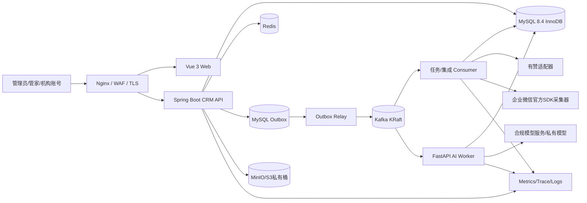

# 20 系统架构与 ADR

## 1. 推荐拓扑


## 2. 不推荐“一开始全部微服务”
主业务为**模块化单体**（单项目/单库，每领域独立 package/service/repository/controller）：identity, customer, marketing, product, order, payment, entitlement, appointment, redemption, refund, institution, contract, approval, settlement, followup, reporting, configuration, audit。企业微信 SDK、外部订单轮询和 AI worker 作为可独立部署进程。这样跨订单/权益/核销仍能使用单库强事务，降低小团队和大模型生成代码的分布式一致性成本。

## 3. 技术栈与职责分界
- MySQL：唯一可信主数据、支付和权益账本、审批流水、事务 Outbox/Inbox。
- Redis：字典/机构列表缓存、API 限流、临时幂等响应（DB 另持久化）、分布式工作协调；不是财务锁唯一保障。
- Kafka：有赞/企微同步结果、业务事件、提醒、AI、数据分析；异步消费实现最终一致，全部可重放与 DLQ。
- 对象存储：合同、证照、付款截图、核销凭证、聊天合法存档媒体，需私有桶、病毒扫描、审计。
- AI：只输出待确认建议和证据，不能直接写正式资金与履约状态；上下文按授权范围裁剪。
- 报表：第一阶段使用可核查 MySQL 查询/日汇总，达到容量阈值再用列式 OLAP；不提前部署过多平台。

## 4. 同步事务与异步事件
`支付确认` 写 payment_txn + order_status + entitlement_grant + entitlement_ledger + outbox_event，**同一 MySQL 本地事务提交**。提交后 Outbox Relay 可靠发 Kafka。Kafka 消费者可重复消费，通过 Inbox 唯一约束和领域幂等保证不会重复创建权益。不要写“先 DB 后 Kafka”两次不原子的代码。

## 5. ADR（需保留决策记录）
- ADR-001：MySQL 8.4 + 单库跨领域本地事务；一旦未来拆库，再改为 Saga，禁止当前使用跨库分布式事务。
- ADR-002：资金整数分；数量整数；费率 `DECIMAL(10,6)`；比例算出结果需记录舍入和分摊依据。
- ADR-003：权益流水为事实，快照用于加速；确认核销使用 DB 行锁与幂等键。
- ADR-004：Kafka 至少一次处理，消费者幂等；不承诺无条件 exactly-once 端到端跨 MySQL。
- ADR-005：权限以服务端过滤为准；机构/管家隔离不可前端模拟。
- ADR-006：官方企微 SDK；有赞真实 API 权限待接入后确认。
- ADR-007：模块目录不能因 AI 生成习惯随意跨领域访问数据库 Mapper，域边界通过 application service。
- ADR-008：Dify 知识问答与证据抽取配置分离，外部 Chatflow 仅经 FastAPI AI Worker Adapter 调用；CRM 负责租户、权限、加密配置与审计，浏览器不持有 Dify Key。真实 HTTP 默认由 `FEATURE_REAL_DIFY=false` 阻断；知识结果不得直接形成资金、履约或其他正式业务事实。
- ADR-009：尚未绑定订单或客户的 PAYMENT 凭证仅允许非机构用户在具备 `order:confirm_payment` 和 CUSTOMER ALL 数据范围时使用；读取还需 `order:read`。
- ADR-010：上传临时文件经校验和扫描后，将扫描内容流式写入服务端新生成的封存 key，通过乐观锁原子切换 key 并发布 CLEAN；历史文件须重新校验、扫描并封存后使用，失败时拒绝访问。EXPORT 保持专用生成链路。
- ADR-011：拟迁移的订单或权益存在任何预约、核销或退款关联时，拒绝自动合并或撤销并回滚事务；撤销仅检查快照中将迁回的资源，无快照时保留 MANUAL_REVIEW。资源锁与关联当前读共同保障并发检查。

## 6. 服务模块代码结构（建议）
```
repo/
  apps/web/                     # Vue 3
  services/crm-api/             # Spring Boot 模块化单体
    src/main/java/.../{identity,customer,product,order,payment,entitlement,appointment,redemption,refund,institution,contract,approval,settlement,followup,integrations,reporting,common}/
    src/main/resources/db/migration/
  services/integration-worker/  # Kafka/SDK适配（可在同一JVM先部署独立进程）
  services/ai-worker/           # FastAPI
  contracts/openapi/ contracts/events/
  infra/dev/ infra/prod/ scripts/ tests/e2e/
  docs/ adr/
```

## 7. 请求的完整链路
HTTP → 认证/租户上下文 → Service 数据范围 → 参数校验/领域状态机 → MySQL TX → outbox → 返回明确状态 → 异步 Kafka → 外部同步/提醒/AI → 消费幂等 → 审计/可观测。日志不得打印身份证、完整电话、银行账号、聊天全文或模型提示词中的原始医疗内容。
