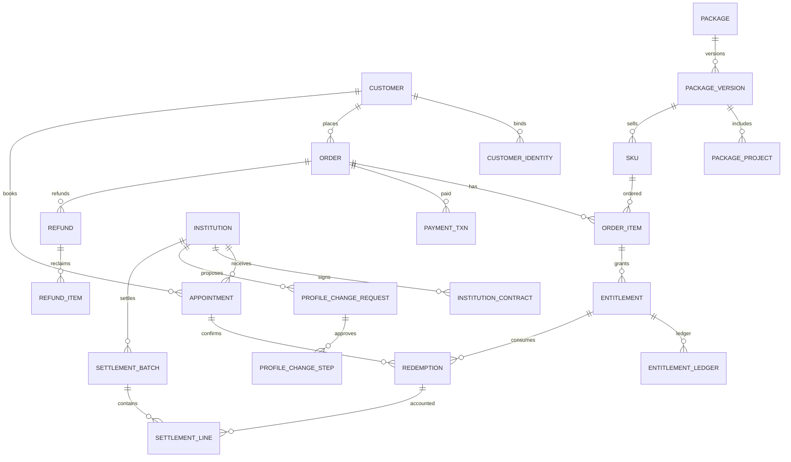

# 30 MySQL 建模规范、核心 ER 与数据库约束

## 1. 基线
MySQL 8.4 LTS / InnoDB / utf8mb4；物理单库 `medical_crm`；69 张设计参考表见 `31_数据库字段字典.md` 与 `07_可执行参考/schema.mysql8.4.reference.sql`。生产只能通过 **Flyway 版本化迁移**演进，不允许运行时依赖自动 DDL 或手工改表。

**基线脚本是开发蓝图，不代表 69 表均已实现功能**。表结构为独立实体建议，缺省业务字段、约束要在相应阶段评审调整，不允许只运行脚本就认定完工。

## 2. 基础约定
| 设计项 | 强制要求 | 原因 |
|---|---|---|
| PK | BIGINT UNSIGNED 服务端生成，自增可用于单库；外部编号单独稳定字符串 | 不使用手机号/微信昵称做主键 |
| 时间 | DATETIME(3) UTC，API ISO8601带时区；报告前端按授权业务时区展示 | 跨日期一致 |
| 资金 | BIGINT 单位分，可负仅允许账本调整；严禁浮点 | 防精度损失 |
| 费率 | DECIMAL(10,6)，明确比例是 0.2 还是 20% | 算法确定性 |
| 次数 | INT，校验非负累计/单次核销正整数 | 权益会计 |
| 并发 | `version` 乐观锁用于编辑；资金/权益用事务+行锁 | 避免丢更新 |
| 状态 | code 字段 + 状态机，不依赖中文 label | 不受字典改名影响 |
| 历史 | 权益/支付/核销/审计 append-only，软删除只能用于非事实数据 | 可追溯 |
| 隔离 | 所有表 `tenant_id`，跨租户外键只引用正确租户ID（Service检查） | 便于未来扩展 |
| 密钥 | 联系方式/银行字段密文 `_cipher`，另存规范化盲索引/Hash 做查重 | 隐私保护 |

## 3. 重点 ER

## 4. 关键唯一与并发约束
- `crm_order(tenant_id, order_no)` 唯一；有赞原订单 `tenant_id+source_system+external_order_no` 唯一（非空时）；`crm_youzan_order_raw(shop_id, external_order_no)` 唯一。
- `crm_entitlement_ledger(tenant_id,idempotency_key)` 唯一；`crm_redemption(tenant_id,idempotency_key)` 唯一；`crm_inbox_event(group,event_id)` 唯一。
- `crm_wecom_message(corp_id,msg_id)` 唯一；cursor 依据 corp/archive_scope 更新成功 seq 时单调递增。
- `crm_profile_change_step(request_id,step_order)` 唯一；同一申请不允许财务审核绕开市场步骤。
- 同一订单行同一子项目一般只设单一 entitlement 批次；若有多次赠送/延期，应通过流水/扩展批次记录。限制 `grant_count` 是非负值且先验证套餐选项物化。

## 5. 待后续补充
- 第 1 阶段需要建立 `status_history` 独立表（可以通过 audit + domain transition 实现但建议显式）与库存/预占（如果存在预约保留次数业务）。
- 基线的 69 表是**跨阶段目标数据模型**，P0 Flyway 应拆分按依赖创建，而非部署后立即全部启用。
- FKs 样例只给核心关系；其余需在对应领域 PR 完善引用完整性或选择受控逻辑 FK 并解释依据。
- `tenant_id` + 自增 ID 在跨租户行关联时需要服务层双重校验；若未来正式多租户隔离，应考虑组合引用唯一约束和扩展 FK。

## 6. 事务隔离和慢查询
常规 READ COMMITTED/REPEATABLE READ 根据 MySQL 实测与业务选择；锁权益行 `FOR UPDATE` 的逻辑不可被无锁读代替。事务内不执行网络 API/模型推理。慢查询必须经过 EXPLAIN 与真实数据索引测试，不要因为小样本快而认为可上线。

官方依据：https://dev.mysql.com/doc/refman/8.4/en/innodb-locking-transaction-model.html
